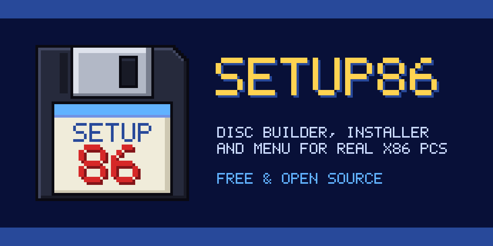
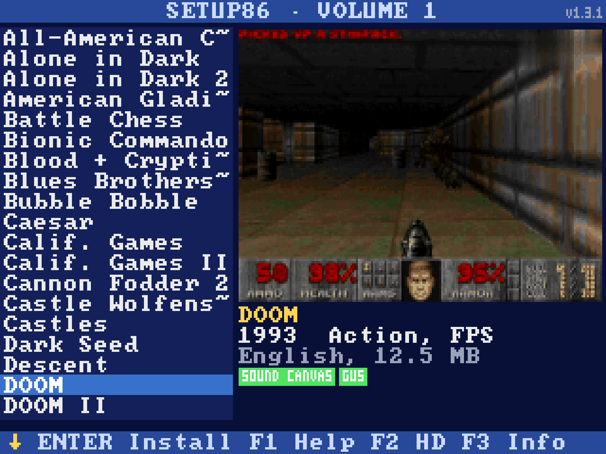
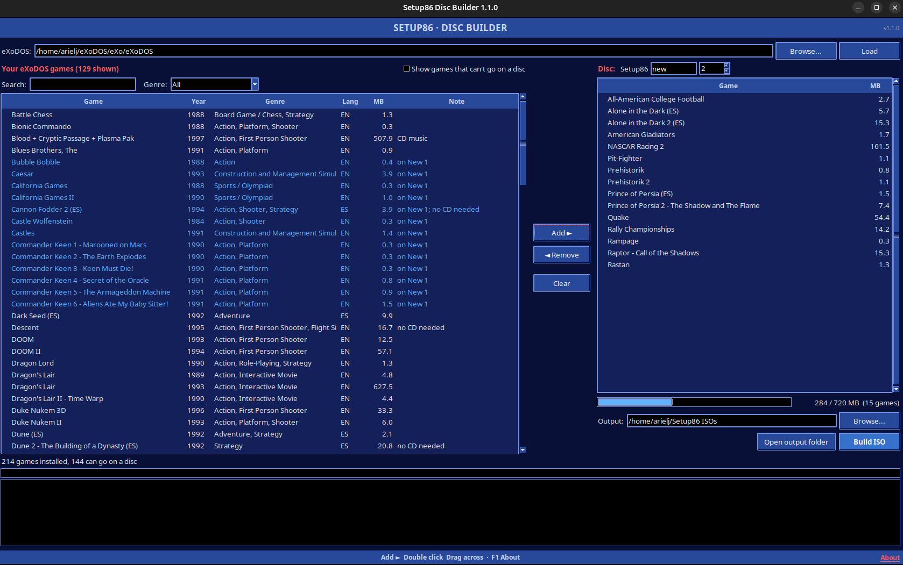
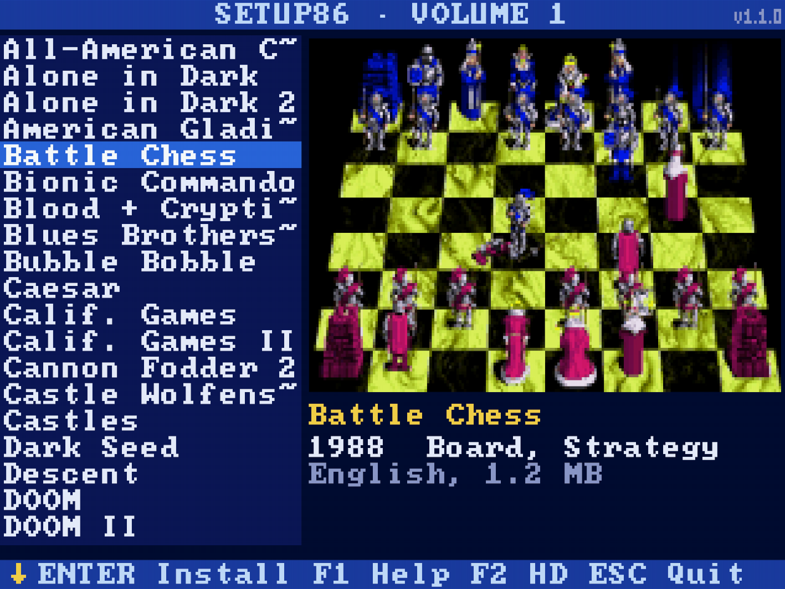
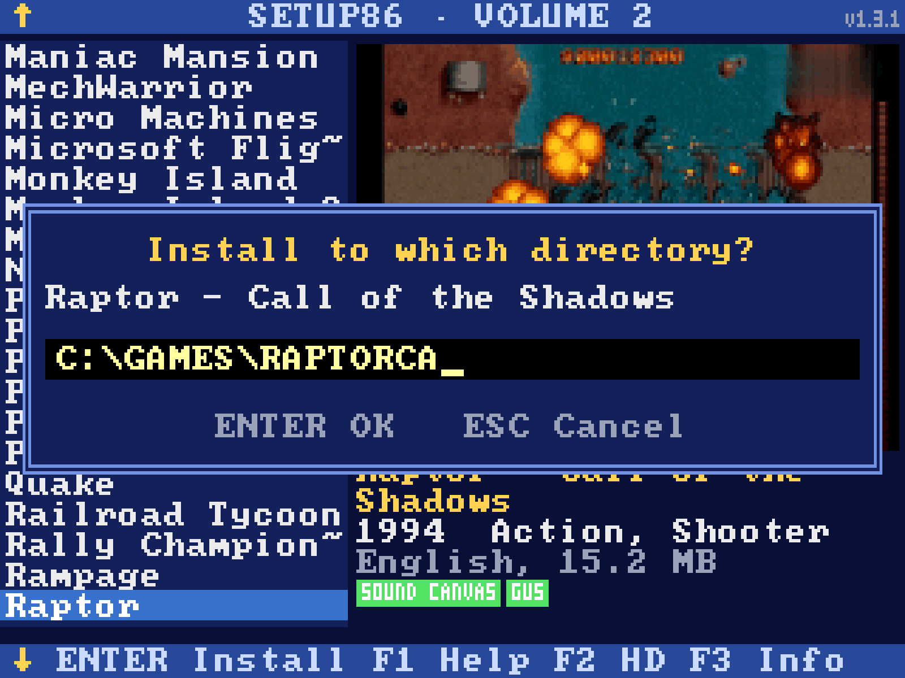
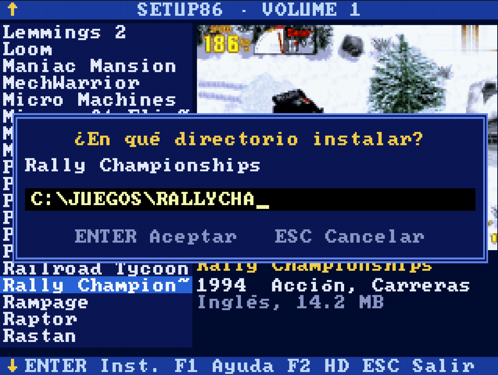
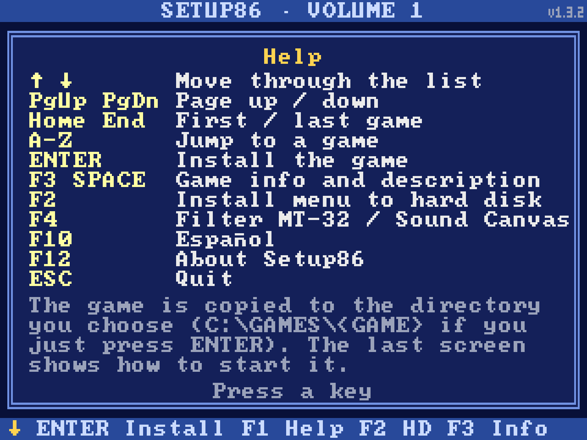
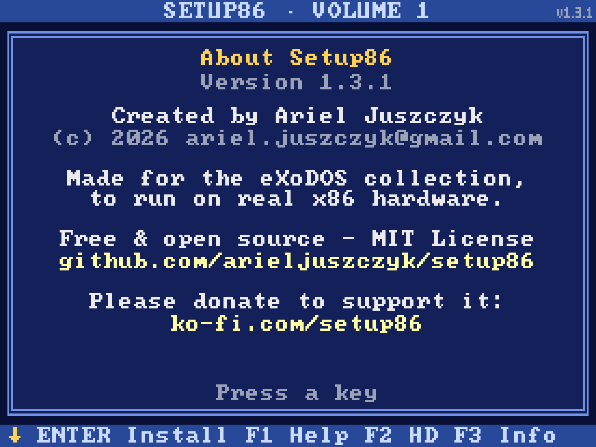

<p align="center">
  
</p>

<p align="center">
  Your <a href="https://www.retro-exo.com/exodos.html">eXoDOS</a> collection on real DOS hardware. Setup86 turns the games you've installed into burnable CDs, each with a graphical VGA install menu, for a real DOS PC.
</p>

<p align="center">
  <a href="LICENSE"></a>
  
  
  
  <a href="https://ko-fi.com/setup86"></a>
</p>

<p align="center">
  
</p>

## Quick start

1. **Install some games with [Exodium](https://github.com/tvollstaedt/exodium)**: every game you download there can go on a disc.
2. **Get Setup86**:
   - **Windows**: download `Setup86.exe` from the [latest release](https://github.com/arieljuszczyk/setup86/releases/latest) and run it.
   - **Linux**: see [Installation](#installation), then run `./setup86.sh` in the `setup86` folder.
3. **Fill a disc**: choose your eXoDOS folder, then move games from the left (your eXoDOS games) to the
   right (the disc) with **Add ►**, a double click or by dragging them. The bar shows how much of the
   720 MB CD is used.
4. **Build ISO**. The app makes the disc with its menu, then moves on to the next volume; games
   already on a disc are marked.
5. **Burn** the ISO to a CD-R. To try it first: `./dosbox-test.sh <ISO>` or mount the image with any image software.
6. **On the DOS PC**, put the CD in and run `D:\MENU`. Pick a game, press Enter, and play.

Prefer the command line? `setup86.py` builds every installed game into as many discs as it takes:
see [Build and burn](#build-and-burn).

## What's on a Setup86 disc

eXoDOS games are set up for DOSBox: each one comes with launchers, DOSBox settings, emulator helpers
and several copies of its sound setup. A Setup86 disc keeps the original files, only what a real DOS PC needs:

| On the CD | What it is |
|---|---|
| `\DOOM\`, `\KQ6CD\`, ... | each game's own DOS files, with 8.3 names, ready to copy to `C:` |
| `MENU.EXE` | the VGA menu: a screenshot, year, genre, language, size and MIDI support (MT-32, Sound Canvas) for each game, and a short description with **F3**. **Enter** installs a game after checking the free space and tells you how to start it. **F10** switches between English and Spanish |
| `INSTALL.EXE` | puts the menu on the hard disk (`C:\SETUP86`), where every disc you add shows up in one list and the menu asks for the right volume |
| `TXTMENU.BAT` | a text-mode menu for PCs without VGA |
| `SETUP86.ID` | tells the hard-disk menu which volume the disc is |

It runs on anything from an 8086 with VGA to a Pentium, with DOS 3.3 or later.

## Making discs

- **The Disc Builder app** (Windows and Linux): choose the games for each disc yourself.
- **The command line** (`setup86.py`): every installed game in as many discs as it takes, genre
  collections, and new discs that continue a series you already burned.
- **Spanish versions** go on the disc instead of the English ones when you've downloaded them with eXoDOS colection or in Exodium.
- **Next up:** classic eXoDOS installs (LaunchBox / exogui, games still zipped), not only Exodium.

## Good to know

- **Games that need their own CD** (The 7th Guest, Rayman, Tomb Raider, ...) stay off the discs:
  burn each of those from its own CD image.
- **Some CD games don't need the CD.** eXo starts games like Quake, Blood and Descent with their CD
  mounted, but they run from the hard disk. Setup86 tested those and puts them on the discs. If their
  music is CD audio, it plays only with the original CD in the drive, and the menu says so.
- **Sound:** each game keeps the sound settings eXo last used. Run the game's own SETUP or INSTALL
  once for your real sound card.
- **Converted automatically:** games without a hand-checked entry are converted from eXo's settings
  and listed when you build. Try those on the PC.
- **Manual questions:** some games ask a word from their printed manual (IndyCar Racing, WarCraft).
  Put the codes on the disc with the extra-files folder (see [Technical details](#technical-details)).

## Screenshots

<p align="center">
  
  <br><sub>The Disc Builder app: your eXoDOS games on the left, the disc on the right.</sub>
</p>

<table>
  <tr>
    <td colspan="2" align="center"><br><sub>Every game with its screenshot, year, genre, language and size.</sub></td>
  </tr>
  <tr>
    <td width="50%"><br><sub><b>Enter</b>: pick a folder and the game is copied to your hard disk.</sub></td>
    <td width="50%"><br><sub><b>F10</b>: every screen in Spanish too.</sub></td>
  </tr>
  <tr>
    <td width="50%"><br><sub><b>F1</b>: the keys.</sub></td>
    <td width="50%"><br><sub><b>F12</b>: About.</sub></td>
  </tr>
</table>

## Installation

### What you need

**On the PC that builds the discs** (Linux):
- [Exodium](https://github.com/tvollstaedt/exodium) with the games you want already downloaded or eXoDOS colection
- Python 3 with [pycdlib](https://github.com/clalancette/pycdlib) and [Pillow](https://python-pillow.org)
- [ffmpeg](https://ffmpeg.org), for the game screenshots
- A CD burner, or a way to get the ISO to one

**On the DOS PC**:
- Any x86 CPU, MS-DOS 3.3 or later
- VGA for the graphical menu (the text menu needs DOS 6 and works without VGA)
- A CD-ROM drive with its DOS driver and MSCDEX

### The Disc Builder app

**Windows**: download `Setup86.exe` from the [latest release](https://github.com/arieljuszczyk/setup86/releases/latest).
It has everything inside: no Python needed. Windows may warn that it is an unrecognized app (it is not
signed): choose "More info" and "Run anyway".

**Linux**: set up Setup86 as below (plus Tkinter: `sudo apt install python3-tk` on Debian/Ubuntu), then
run `./setup86.sh` from the `setup86` folder (it uses the venv by itself). `./setup86.sh --desktop`
adds Setup86, with its icon, to the app menu and dock.

Choose your eXoDOS folder (the one with `eXo` inside). The left side lists your installed games, with
their size and a note when eXo mounts their CD but they run without it. Tick **Show games that can't
go on a disc** to see the others and why. Move games to the disc on the right, set the series and
number (Setup86 Volume 1, 2...), and press **Build ISO**. Each disc goes into its own folder in the
output folder, with its ISO and its `DISCn.TXT`.

### Set up Setup86

```sh
git clone https://github.com/arieljuszczyk/setup86
cd setup86
python3 -m venv ~/.venvs/setup86
~/.venvs/setup86/bin/pip install pycdlib pillow
```

### Build and burn

```sh
~/.venvs/setup86/bin/python setup86.py ~/eXoDOS/eXo/eXoDOS isos --iso all
```

The output folder (`isos/` here, which git ignores) has one `SETUP86-VOLUME-nn.ISO` per disc, a
`DISCn/` folder per disc, and a `DISCn.TXT` that lists where each game goes and how to start it.
Without `--iso all`, only disc 1 gets an ISO.

Try the ISO in DOSBox first with `./dosbox-test.sh [ISO]` (disc 1 by default). It mounts the ISO as `D:` and a folder
as `C:`, then starts the menu. Then burn it with any CD burning app (K3b, Brasero, …). A low speed
(8-16x) is easier on old CD-ROM drives.

### On the DOS PC

| Key | What it does |
|---|---|
| ↑ ↓, PgUp PgDn, Home End | Move through the list |
| A-Z | Jump to the next game starting with that letter |
| Enter | Install the game (default `C:\GAMES\<GAME>`) |
| F3 or Space | Game info: MIDI support (Roland MT-32, Sound Canvas) and a short description |
| F1 | Help |
| F2 | Install the menu to the hard disk (`C:\SETUP86`), with all your discs in one list |
| F10 | English / Español |
| F12 | About (needs a 101-key keyboard) |
| Esc | Quit |

### More discs later

Keep the `DISCn.TXT` of each disc you burn, outside the output folder, and pass it on the next
build. Those games are skipped, and the new discs continue the numbering:

```sh
~/.venvs/setup86/bin/python setup86.py ~/eXoDOS/eXo/eXoDOS isos --iso all \
    --burned ~/eXoDOS/burned/DISC1.TXT --first 2
```

For a genre collection: `--genre adventure --series Adventure`, into its own output folder.

## How it's made

The menu that runs on the DOS PC, `MENU.EXE`, is written in **C for 16-bit DOS** and built with
[OpenWatcom 2](https://github.com/open-watcom/open-watcom-v2): real mode, VGA mode 13h, its own
graphics and font drawing, and a ~48 KB program that runs on an 8086. The tiny `GETLINE.COM` used
by the text menu is 8086 assembly. The disc builder, `setup86.py`, is Python.

Setup86 was developed with the help of [Claude Code](https://claude.com/claude-code), Anthropic's
AI coding assistant.

## Technical details

<details>
<summary><b>What goes on the discs, and what is left out</b></summary>

Setup86 copies only the DOS files of the installed games in `~/eXoDOS/eXo/eXoDOS/<game>/`: what
eXo's `dosbox.conf` mounted as `C:\` for the game. **No launchers or installers are added.**

Removed: eXo menus (`run.bat`), DOSBox commands, IPX/null-modem network scripts, `.exo` and 0-byte
marker files, DOSBox GUS driver folders, cracks, CD/floppy images, eXo sound presets (`SB16\`,
`GUS\`, `SC55\`, `MT32\`, `Tandy\`, `Herc\`...: folders whose files are all copies of files in the
parent; kept when a menu option copies from them), and helpers eXo adds (DOOMATIC, `*_patch.exe`,
FAKEHMA, BMOUSE, glide/3dfx emulation DLLs, `.ips`, `.bak`, `.pdf`, `.chm`, Duke3D's guide demos).

- **Packing**: alphabetical by folder name, 720 MB per disc (80-min CD-R). A game that doesn't fit
  waits, and the following (smaller) games still go on the current disc.
- **Left out**: any game where eXo mounts a CD (`imgmount`/`mount ... -t cdrom` in its config, or a
  CD from the game's own `cd\` folder in its `run.bat` menu). Each of those gets burned onto its own
  CD and installed from it. Exceptions:
  - **Games that run without their CD** (`NO_CD_NEEDED`): checked in DOSBox with another disc in
    the drive, they started and played (Quake, Blood, Descent, Heretic, Hexen, King's Quest VII...).
    Their CD only holds the installer, extras, other languages or CD-audio music; for the ones whose
    music is CD audio, the run notes say it needs the original CD.
  - **Spanish packs that also ship a floppy version** (Dark Seed, Dune, Gobliiins 1-3, Loom, Space
    Quest IV) go on the data disc as that floppy version, via a hand entry.
- **A disc of its own** (`solo=True` in a game's entry): Dragon's Lair (1993), 627 MB of video, gets
  the last disc to itself instead of filling most of a shared one.
- **Added files**: files in `~/eXoDOS/.setup86-add/<game>/` (or `add/` in the `--data` folder) go into
  that game's folder on the disc, e.g. `IndyCarR/CODES.PDF` with the manual's copy-protection codes.
  Non-8.3 names are shortened.
- **Spanish first**: if a game's Spanish version is downloaded (`eXoDOS/!spanish/<game>` +
  `!dos/!spanish/<game>/dosbox.conf`), it's used instead of English (`[ESPANOL]` in `DISCn.TXT`).
  The `!spanish/*.zip` files are 0-byte Exodium placeholders. The run's output lists games with a
  Spanish version in eXo that isn't downloaded yet: get them in Exodium and rerun.
- **Special cases handled**:
  - **Games that run from a floppy image:** for example Italy 90, which eXo mounts as `A:` and starts there. The image is FAT12/16, and its files (minus the floppy's own DOS boot files) are extracted into the game folder.
  - **Self-booting games** (eXo uses `BOOT`) are skipped with a message: write their image to a real floppy.
  - **Windows-only folders** (all `.EXE` are Windows GUI, such as the AGS fan remakes KQ3 Redux and KQ4 Retold) are dropped.
  - **Folders whose name isn't 8.3** are dropped and listed.
  - **A `floppy` folder** is skipped only if it holds nothing but images.
  - **Original releases only**: fan-made content is left out.
    - **Fan add-ons**: the Monkey Island 1/2 Spanish fan talkies, the LSL3 mouse mod (`LS3pp`) and the Plutonia MIDI pack (`plutmid`). The official Indy 4 CD talkie stays.
    - **Fan games** (`FAN_GAMES`): Commander Keen 7-9.
    - **Modern ports** (`PORTS`): the 2024 Quake II DOS port. Original DOS releases only.
    - **Fan translations** (`FAN_TRANSLATIONS`): KQ1, LSL1-3, SQ3, SQ5 (with a fan voice dub) and X-COM use the English original instead. If English isn't downloaded, the game is left out and listed.
  - **Hand entries per language**: an entry with `lang='es'` is used only for the Spanish version. Use the key `<game>:es` when the English version already has an entry (e.g. `dune:es`).
  - **Spanish versions eXo runs only in ScummVM** (no DOS config) are listed, so you can get the English one.
- **Auto-converted games**: the games in the `G` table have hand-checked notes. Any other game is
  auto-converted from its eXo config and listed under WARNINGS. Test those on the PC, and add a `G`
  entry if one needs fixing.
- **Sound**: each game keeps the config eXo last used (often Sound Blaster at DOSBox's
  `A220 I7 D1 H5`). For your real card, run the game's own SETUP/INSTALL program.

</details>

<details>
<summary><b>Output files</b></summary>

Output (`isos/` in the examples, rebuilt each run; folders are hardlinks, so only ISOs use space):

| Path | What |
|---|---|
| `SETUP86-VOLUME-nn.ISO` | the disc (CD label `SETUP86_Vnn`): one folder per game at the root, `\<GAME>\...` (exact DOS 8.3 names) |
| `DISCn/` | the same as folders |
| `MENU.EXE` + `_MENU\` (on each disc) | graphical install menu: `MENU.DAT` (list, run notes) + one `<GAME>.PIC` screenshot per game |
| `INSTALL.EXE` (on each disc) | the same program: started by this name, it installs the menu on the hard disk |
| `SETUP86.ID` (on each disc) | which disc this is: `SET <series>`, `VOL <n>`, `BUILD <yyyymmddhhmm>` |
| `TXTMENU.BAT` + `GETLINE.COM` (on each disc) | text-mode fallback menu, see below |
| `DISCn.TXT` | per game: where it goes on `C:` and how to start it (not on the disc) |

</details>

<details>
<summary><b>Building from a copy on another PC or a network share</b></summary>

Point `src` at the copied `eXo/eXoDOS` folder. The inputs that live outside it go in an
`setup86-data` folder next to it (found automatically), or anywhere with `--data DIR`:

| In `setup86-data/` | Copied from (Exodium's own location) | Without it |
|---|---|---|
| `exodium.db` | `~/.local/share/com.redfox.exodium/exodium.db` | no titles/years/genres in the menu, `--genre` matches nothing |
| `shots/` | `~/eXoDOS/.setup86-cache/shots/` | screenshots are made again from `GameData/` or `posters/` |
| `GameData/` | `~/eXoDOS/Content/GameData/eXoDOS/` | no new video screenshots |
| `posters/` | `~/content/posters/eXoDOS/` | no box-art fallback |

When `src` is on another filesystem (e.g. SMB), the output folders are copies rather than
hardlinks, so they take real space.

</details>

<details>
<summary><b>Build options</b></summary>

- **Series and genre collections**: discs are named "Setup86 <series> <n>" (`--series`, default
  `Volume`). `--genre adventure --series Adventure` builds only one genre into
  `SETUP86-ADVENTURE-01.ISO`, ... Use its own output folder, e.g. `~/eXoDOS/SETUP86-ADVENTURE`. The
  genre comes from Exodium's database (`~/.local/share/com.redfox.exodium/exodium.db`, read-only).
  A game matches if its genre contains the word and not "Action" (so no action-adventures or
  interactive movies), unless you ask for `--genre action`.
- **ISOs**: by default only disc 1 gets an ISO. Use `--iso 2`, `--iso all` or `--iso none`.
- **After burning a disc**: keep its `DISCn.TXT` outside the output folder (it is rebuilt) and pass
  it on later runs: `--burned ~/eXoDOS/burned/DISC1.TXT`. Its games are skipped, so new games (even
  ones starting with A) go onto the next discs instead of reshuffling. Add `--first N` so the new
  discs continue the numbering of that series (e.g. `--first 3` builds Volume 3, 4...): an installed
  menu tells discs apart by series + number.

</details>

<details>
<summary><b>The menu (MENU.EXE) in detail</b></summary>

- **On the DOS PC**: from the CD drive (`D:`) run `MENU`. It needs VGA (any CPU, DOS 3.3+).
  - **Screen**: the game list on the left, and a screenshot, title, year, genre, language and size on the right. Green **MT-32** / **SC-55** tags mark games with Roland MT-32 or Sound Canvas (SC-55) music, from eXo's "Games with MT-32" and "Games with Sound Canvas" playlists in Exodium's database.
  - **F3** (or Space) shows the game's info screen: year, genre, MIDI support and a short description (Exodium's, cut to whole sentences that fit; `_MENU\<GAME>.TXT`). Enter there installs it.
  - **Keys**: arrows, PgUp/PgDn, Home/End, or a letter to jump to the next game with that initial.
  - **F1** shows a help screen. **F10** switches every screen between English and Spanish: header, help, dialogs, language and genre (`GENRE_ES` in `MENU.DAT`). Accents use the VGA font's own CP437 characters. Game titles and play commands aren't translated.
  - **F12** shows the About screen: credits, the GitHub page, the license and the Ko-fi link. It needs a 101-key keyboard; older 84-key keyboards have no F12.
  - **Enter**: asks for the directory (default `C:\GAMES\<GAME>`, or `C:\JUEGOS\<GAME>` in Spanish; checked as an 8.3 path). It checks free space (cluster-rounded) and warns if the directory already has files. Then it copies with a progress bar (Esc stops) and shows how to start the game.
- **Menu on the hard disk** (the whole collection in one list): run `D:\INSTALL` (or press F2 in
  the disc's menu). It asks for the directory (default `C:\SETUP86`, editable) and copies the program
  plus that disc's list and screenshots there. Start it with `C:\SETUP86\MENU`.
  - It lists the games of every disc it knows, each with its disc ("Disc Volume 3"), sorted by name.
  - **Installing** looks for that disc in the CD drives (MSCDEX, any number of drives) by its
    `SETUP86.ID`, and asks "Insert Setup86 Volume 3" if it isn't there.
  - **Adding discs**: at start, and with F2, a disc in the drive that the list doesn't know yet is
    offered for adding. A disc with the same series and number but another `BUILD` (re-burned) is
    offered as an update of that disc's entries. Running `INSTALL` again on an existing folder also
    adds or updates that disc there.
  - **Files**: `_MENU\VOLS.DAT` (one line per disc, `<series> <n> <build>`; line n is disc n of the
    list), `_MENU\Vnnn.DAT` (that disc's `MENU.DAT`) and `_MENU\Vnnn\*.PIC`.
  - Disk errors (empty drive, disc being changed) are failed quietly by a critical-error handler,
    so DOS's "Abort, Retry, Fail?" never lands on the VGA screen.
- **Screenshots**: a frame from eXo's gameplay video in `~/eXoDOS/Content/GameData/eXoDOS/<game>.zip`. Exodium downloads it with the game.
  - **Frame choice**: the most detailed of 7 frames (20-80% into the video). eXo's logo is painted out (ffmpeg `delogo`), then the frame is scaled to 192x120 and reduced to 240 colours.
  - **Fallback**: no video means the box art from Exodium's posters pack (`~/content/posters/eXoDOS/`).
  - **Cache**: `~/eXoDOS/.setup86-cache/shots/<game>.png`. Delete a file there to pick a new frame, or drop your own 192x120 PNG in its place.
- **Text menu** (`TXTMENU`, fallback without VGA): it lists the games (2 columns,
  `N`/`P` to page), you type the game number, then the destination (Enter =
  `C:\GAMES\<GAME>`), confirm `Y`, and it runs `XCOPY /S /E` + `ATTRIB -R /S` and shows
  how to start the game. By hand: `XCOPY D:\CKEEN1\*.* C:\GAMES\CKEEN1\ /S /E`.
  Games that had several C:\ folders (Blood, Final DOOM) have them as subfolders.
- **GETLINE.COM**: MS-DOS 6 batch files can't read typed text (`SET /P` is NT-only), so
  this 311-byte 8086 program reads a line and writes `SET <VAR>=<text>` to `C:\_M.BAT`,
  which `TXTMENU.BAT` then `CALL`s. Source is `getline.s` (the script embeds the built
  bytes). `test_getline.py` runs it in a CPU emulator with simulated keystrokes. The menu
  needs `CHOICE` (DOS 6) and writes the temp file to `C:\`. It uses only 4 short variables.
  If DOS still says "Out of environment space", add `/E:1024` to `SHELL=` in CONFIG.SYS.

</details>

<details>
<summary><b>Development: building and testing MENU.EXE</b></summary>

- **Source**: `dosmenu/menu.c`, C for OpenWatcom 2 (16-bit real mode, mode 13h). The built `dosmenu/MENU.EXE` is committed and copied onto each disc.
- **Build**: unpack OpenWatcom's `ow-snapshot.tar.xz` into `~/.local/opt/openwatcom`, then run `WATCOM=~/.local/opt/openwatcom PATH=$WATCOM/binl64:$PATH INCLUDE=$WATCOM/h wcl -q -w4 -bt=dos -ml -0 -os -k12288 -fe=MENU.EXE menu.c`.
- **Test**: `MENU /T:KEYS.TXT` reads keys from a file (`UP DOWN ENTER ESC SPACE F1 F2 F3 F10 F12 SHOT TEXT:abc`...). `SHOT` dumps the screen to `SHOTnn.BIN` (768-byte palette + 64000 pixels). It runs headless in Exodium's `dosbox-staging` (`SDL_VIDEODRIVER=dummy`), with the ISO mounted via `imgmount d X.ISO -t iso`.
- **Try a disc on this PC**: `./dosbox-test.sh [ISO] [C-folder]`. It mounts the ISO as `D:` and a folder (default `~/eXoDOS/dosbox-c`, kept between runs) as `C:` in Exodium's `dosbox-staging`, then starts the menu. Without arguments it tries `isos/SETUP86-VOLUME-01.ISO`. Ctrl+F10 frees the mouse; Ctrl+F9 or `exit` quits DOSBox.

</details>

## Credits

The games come from [eXoDOS](https://www.retro-exo.com/exodos.html), the DOS collection eXo has built
and maintained for years, and Setup86 reads them as [Exodium](https://github.com/tvollstaedt/exodium)
downloads them. Setup86 doesn't include or download any games. If you like what it does, support the
eXoDOS project at [retro-exo.com](https://www.retro-exo.com).

## Disclaimer

- **No games included.** Setup86 is a tool: it contains no games, eXoDOS files or box art (the
  screenshots in `docs/` only show what the menu looks like). It only works on an eXoDOS / Exodium
  install you already have.
- **Not affiliated** with eXoDOS, the eXo team or Exodium. All game names and trademarks belong
  to their owners.
- **Personal use.** The discs you build contain games that are still under copyright. Build them
  for your own computers, for games you are entitled to use. **Don't share, sell or upload the
  discs or ISOs**, and please don't ask for them: none will be provided.
- **No warranty.** Provided "as is" (see the license). It writes to your hard disk on a real DOS
  PC: keep backups of anything important there.

## Support the project

Setup86 is free and stays free. If it brought an old PC back to life and you'd like to say thanks,
you can buy me a coffee:

[](https://ko-fi.com/setup86)

Donations support the development of this tool only. They never pay for games or discs, and
there are no rewards. Bug reports, tests on real hardware and pull requests are just as welcome.

## License

MIT, see [LICENSE](LICENSE). `MENU.EXE` shows the license notice when you quit it.
